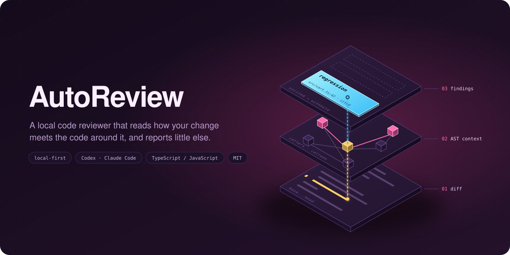

<p align="center">
  
</p>

<p align="center">
  <a href="#first-run">First run</a> ·
  <a href="#how-it-works">How it works</a> ·
  <a href="#review-a-branch">Review a branch</a> ·
  <a href="docs/internals/architecture.md">Architecture</a>
</p>

# AutoReview

An open-source code reviewer that runs locally and uses the coding agent you already have installed. It looks for concrete regressions by reading how a change interacts with the surrounding code, and it reports little else.

> [!WARNING]
> **Work in progress.** AutoReview is an early prototype. Commands, flags, and the report format change without notice, and nothing here is released or versioned yet.
>
> The local reviewer supports Codex and Claude Code, reviews committed JavaScript and TypeScript changes, and has not yet been measured against a labeled set of real bugs. Treat its findings as leads, and a clean report as "nothing found", not "bug-free".

## How it works

The graphic above is the whole pipeline, bottom to top.

1. **Diff.** AutoReview checks out the merge base and HEAD in temporary worktrees and reads the changed lines.
2. **AST context.** For each changed symbol it pulls in the callers, callees, and imports, so the agent sees the code the change touches and not only the hunk.
3. **Findings.** Detector passes run through your coding agent. Every finding must cite source that was actually collected. A finding whose citation doesn't match is withheld, and the JSON report still lists it.

## Requirements

- Node.js 22.12 or newer
- [Vite+](https://viteplus.dev/) (`vp`) and pnpm
- [Codex CLI](https://github.com/openai/codex) or [Claude Code](https://claude.com/claude-code), logged in, for reviews
- [GitHub CLI](https://cli.github.com/), logged in, only for PR snapshots

## First run

```sh
git clone <this repository> && cd auto-review
vp install
pnpm pr review --base HEAD~1 --dry-run --output /tmp/context.json
```

The dry run builds the review context without calling an agent, so it is a safe way to check your setup. Relative paths are resolved from the directory you run the command in; pass `--repo path` to review another repository.

## Review a branch

Commit the changes you want reviewed, then run:

```sh
pnpm pr review --base main
```

AutoReview checks out the merge base and HEAD into temporary Git worktrees, so your checkout is never modified. It collects the changed code plus AST-linked callers, callees, and imports, then runs detector passes through your coding agent. Use `--agent claude` for Claude Code; Codex is the default. Findings whose citations do not match the collected source are withheld.

The terminal shows accepted findings. A JSON report is saved under `outputs/` (or `--output path`) with the revisions, context, accepted and withheld candidates, and coverage limits. Its `status` is `complete`, `partial` (some changed code, config, or context was not reviewed; docs and lockfiles do not count), `failed`, or `cancelled`. Ctrl-C stops the agent and removes the temporary checkouts. Staged, unstaged, and untracked changes are excluded.

Options: `--head ref` (default `HEAD`), `--repo path`, `--agent codex|claude`, `--model id` to override the agent's configured model, `--dry-run`, and `--output path`. Reports stay on your machine, but the agent sends the collected source to its model provider. Each pass records the model and usage when the agent reports them; Claude Code does, Codex does not.

## Other commands

```sh
pnpm pr index . --output /tmp/index.json   # dump the TypeScript/JavaScript AST index
pnpm pr snapshot [number-or-url]           # save a GitHub PR to apps/web/public/pr.json
pnpm run dev                               # dashboard that displays the PR snapshot
```

The dashboard shows PR snapshots (summary, timeline, and code). It does not display review runs yet.

## Development

```sh
vp check
vp test
vp run -r build
pnpm eval --split all   # review the labeled cases in evals/ with both agents
```

Each case in `evals/` is a small before/after repository with a label. The eval prints a table and saves the findings so a person can judge each one.

## License

[MIT](LICENSE)
